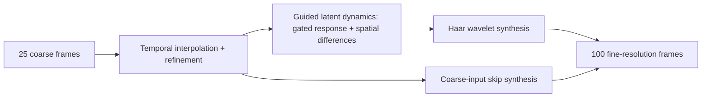

# SLD — Structured Latent Dynamics

### Latent dynamics for reconstructing fine-scale PDE trajectories from coarse observations

**Chenhao Si · Zishan Qian · Shing-Tung Yau · Rongling Wu · Ming Yan**

SLD reconstructs high-resolution PDE trajectories from coarse observations. It combines temporal interpolation and learned refinement, guided latent dynamics with fixed spatial difference operators, and Haar wavelet reconstruction heads.

**25 input frames at 32 × 32 → 100 output frames at 256 × 256**, with two state channels.

This repository contains six SLD experiment notebooks, three dataset generators, and one representative trained SLD checkpoint per PDE and task. Two compact evaluation notebooks run SLD inference and report relative L2 and MAE.

**Raw datasets:** [ChenhaoSI/SLD-dataset on Hugging Face](https://huggingface.co/datasets/ChenhaoSI/SLD-dataset).

## Method



## Experiments

| PDE | Task 1: unseen initial conditions | Task 2: later-time reconstruction | Dataset generation |
| --- | --- | --- | --- |
| Gray–Scott | [Gray-Scott_SLD.ipynb](task1_unseen_ic/Gray-Scott/Gray-Scott_SLD.ipynb) | [Gray-Scott_SLD.ipynb](task2_later_time/Gray-Scott/Gray-Scott_SLD.ipynb) | [Gray-Scott_data.ipynb](data_generation/Gray-Scott/Gray-Scott_data.ipynb) |
| Complex Ginzburg–Landau | [Ginzburg-Landau_SLD.ipynb](task1_unseen_ic/Ginzburg-Landau/Ginzburg-Landau_SLD.ipynb) | [Ginzburg-Landau_SLD.ipynb](task2_later_time/Ginzburg-Landau/Ginzburg-Landau_SLD.ipynb) | [Ginzburg-Landau_data.ipynb](data_generation/Ginzburg-Landau/Ginzburg-Landau_data.ipynb) |
| Vector Burgers | [Burgers_SLD.ipynb](task1_unseen_ic/Burgers/Burgers_SLD.ipynb) | [Burgers_SLD.ipynb](task2_later_time/Burgers/Burgers_SLD.ipynb) | [Burgers_data.ipynb](data_generation/Burgers/Burgers_data.ipynb) |

**Task 1 — unseen initial conditions.** Split the ten trajectories by identity into seven training, two validation, and one test trajectory. Each identity supplies windows beginning at LR indices `100, 150, 200, 250`. Each supplied notebook runs one held-out identity; the manuscript reports aggregation over ten folds.

**Task 2 — later-time reconstruction.** Train on early windows of all ten trajectories (`100, 150, 200`). Use later windows (`225, 250`) from five identities for validation and the other five for testing. The model receives coarse observations from each later window. Each supplied notebook runs one partition; the manuscript reports five repeated partitions.

For every LR start index `s`, the paired HR start is `4*s` in the arrays used by the loader. Each pair contains 25 LR frames and 100 HR frames. Gray–Scott retains the supplied additional temporal slicing; see the reproduction notes below.

## Evaluate the published checkpoints

Open [Task 1 evaluation](task1_unseen_ic/SLD_evaluation.ipynb) or [Task 2 evaluation](task2_later_time/SLD_evaluation.ipynb), run the setup cell, and select the PDEs. Set `DOWNLOAD_DATA=True` to fetch only the required test trajectories from the public Hugging Face dataset, or point `SLD_DATA_ROOT` at existing canonical data folders.

The evaluation restores normalization from the checkpoint and computes metrics over all 100 target frames. It writes small JSON summaries under `results/`, without baseline models, checkpoint aggregation or paper-panel plots. Task 1 evaluates held-out IC 1. Task 2 uses the authors' confirmed PDE-specific training partitions: Gray–Scott seed 4, Ginzburg–Landau seed 48, and Burgers seed 1.

| PDE | Task 1 checkpoint | Task 2 checkpoint |
| --- | --- | --- |
| Gray–Scott | [GS_CaseB_1](task1_unseen_ic/Gray-Scott/checkpoints/GS_CaseB_1_best_model.pth) | [GS_CaseC_1](task2_later_time/Gray-Scott/checkpoints/GS_CaseC_1_best_model.pth) |
| Ginzburg–Landau | [GL_CaseB_1](task1_unseen_ic/Ginzburg-Landau/checkpoints/GL_CaseB_1_best_model.pth) | [GL_CaseC_1](task2_later_time/Ginzburg-Landau/checkpoints/GL_CaseC_1_best_model.pth) |
| Burgers | [Burgers_CaseB_1](task1_unseen_ic/Burgers/checkpoints/Burgers_CaseB_1_best_model.pth) | [Burgers_CaseC_1](task2_later_time/Burgers/checkpoints/Burgers_CaseC_1_best_model.pth) |

Each file is about 2 MiB. [Evaluation details](docs/EVALUATION.md) define splits and metrics; [checkpoint checksums](docs/CHECKPOINTS.json) identify the original supplied files.

## Repository layout

```text
SLD/
├── task1_unseen_ic/
│   ├── SLD_evaluation.ipynb
│   ├── Gray-Scott/Gray-Scott_SLD.ipynb
│   ├── Ginzburg-Landau/Ginzburg-Landau_SLD.ipynb
│   └── Burgers/Burgers_SLD.ipynb
├── task2_later_time/
│   ├── SLD_evaluation.ipynb
│   ├── Gray-Scott/Gray-Scott_SLD.ipynb
│   ├── Ginzburg-Landau/Ginzburg-Landau_SLD.ipynb
│   └── Burgers/Burgers_SLD.ipynb
├── data_generation/
│   ├── Gray-Scott/Gray-Scott_data.ipynb
│   ├── Ginzburg-Landau/Ginzburg-Landau_data.ipynb
│   └── Burgers/Burgers_data.ipynb
├── sld/                     # Shared SLD inference model and evaluator
├── docs/EVALUATION.md
├── docs/REPRODUCIBILITY.md
├── requirements.txt
└── CITATION.cff
```

## Getting started

Use a Python virtual environment. Install a [PyTorch build suitable for your hardware](https://pytorch.org/get-started/locally/), then install the notebook dependencies:

```bash
python -m venv .venv
# macOS / Linux
source .venv/bin/activate
# Windows PowerShell: .venv\Scripts\Activate.ps1
python -m pip install -r requirements.txt
python -m jupyter lab
```

1. Download the raw [Hugging Face dataset](https://huggingface.co/datasets/ChenhaoSI/SLD-dataset), or run a dataset generator. MATLAB `.mat` files belong beneath `data/gray_scott/`, `data/ginzburg_landau/`, or `data/burgers/`. The evaluation notebooks can download their required test files automatically.
2. Open the corresponding SLD notebook under your chosen task and run its cells in order. Review its split configuration and paths before a full training run.
3. Checkpoints, histories, and generated plots are written beneath `results/`. Optional visualization cells require the files identified in their headings.

The setup cell finds the repository root when Jupyter starts in the repository or one of its subdirectories. Set `SLD_DATA_ROOT` or `SLD_RESULTS_ROOT` before starting the kernel to use another data or results location.

A CUDA GPU is useful for full training and evaluation. The code selects CUDA when available and otherwise uses CPU. Raw datasets are hosted on Hugging Face; the six representative checkpoints are included in this repository.

## Data format

All dataset files contain a MATLAB variable named `uv`, with axes `[channel, time, height, width]`.

| PDE | Stored HR trajectory | Stored LR trajectory | HR frame spacing |
| --- | --- | --- | --- |
| Gray–Scott | `[2, 3001, 256, 256]` | `[2, 751, 32, 32]` | `5` |
| Ginzburg–Landau | `[2, 1200, 256, 256]` | `[2, 300, 32, 32]` | `0.0168` |
| Burgers | `[2, 1200, 256, 256]` | `[2, 300, 32, 32]` | `0.001` |

Spatial and temporal reduction factors are eight and four. Gray–Scott and Ginzburg–Landau use pyramid reduction; Burgers uses Fourier cropping. Install `pyrtools` to retain the supplied pyramid operator.

Ten Gray–Scott HR arrays occupy about **29.3 GiB** with the supplied float64 storage. The ten HR arrays for each of the other PDEs occupy about **5.9 GiB** with float32 storage. Simulation and training need additional working memory and result storage.

## Reproducibility and release scope

This release preserves the supplied SLD models, numerical solvers, loss definitions, and training settings while repairing notebook execution and path issues. The Gray–Scott later-time dataset now respects the requested segment starts, matching the task definition.

The supplied Gray–Scott loaders first use `LR[:,50::2]` and `HR[:,200::2]`, then apply their segment starts to those arrays with effective HR spacing `10`. This differs from the manuscript description of indices in the raw stored arrays; that preprocessing is preserved and exact manuscript time-window reproduction is unverified.

The training notebooks provide representative splits and do not automate the manuscript's complete ten-fold/five-partition aggregates. Some unseen-IC training splits use unseeded Python `random`. The published evaluation uses one supplied checkpoint per PDE/task and saved normalization buffers. Checkpoints do not contain the full original train/validation/test identities; Task 1 uses the supplied filename convention, while Task 2 uses the partition configuration confirmed by the authors. Both Burgers tasks now select the shared `sig040_indIC` dataset directly.

See [reproduction details and preparation changes](docs/REPRODUCIBILITY.md) for the exact scope and validation performed.

## Citation

If you use SLD, please cite the manuscript:

> Chenhao Si, Zishan Qian, Rongling Wu, and Ming Yan. *Latent dynamics for reconstructing fine-scale PDE trajectories from coarse observations.*

Publication details will be added when available. The repository provides [CITATION.cff](CITATION.cff) for GitHub's citation interface.
