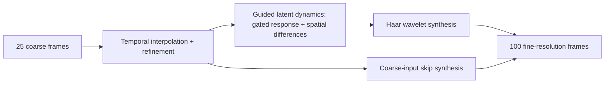

# SLD — Structured Latent Dynamics

### Latent dynamics for reconstructing fine-scale PDE trajectories from coarse observations

**Chenhao Si · Zishan Qian · Rongling Wu · Ming Yan**

SLD reconstructs high-resolution PDE trajectories from coarse observations. It combines temporal interpolation and learned refinement, guided latent dynamics with fixed spatial difference operators, and Haar wavelet reconstruction heads.

**25 input frames at 32 × 32 → 100 output frames at 256 × 256**, with two state channels.

This repository contains six SLD experiment notebooks and three dataset-generation notebooks for two-dimensional Gray–Scott, complex Ginzburg–Landau, and viscous vector Burgers systems.

## Method



## Experiments

| PDE | Task 1: unseen initial conditions | Task 2: later-time reconstruction | Dataset generation |
| --- | --- | --- | --- |
| Gray–Scott | [Gray-Scott_SLD.ipynb](task1_unseen_ic/Gray-Scott/Gray-Scott_SLD.ipynb) | [Gray-Scott_SLD.ipynb](task2_later_time/Gray-Scott/Gray-Scott_SLD.ipynb) | [Gray-Scott_data.ipynb](data_generation/Gray-Scott/Gray-Scott_data.ipynb) |
| Complex Ginzburg–Landau | [Ginzburg-Landau_SLD.ipynb](task1_unseen_ic/Ginzburg-Landau/Ginzburg-Landau_SLD.ipynb) | [Ginzburg-Landau_SLD.ipynb](task2_later_time/Ginzburg-Landau/Ginzburg-Landau_SLD.ipynb) | [Ginzburg-Landau_data.ipynb](data_generation/Ginzburg-Landau/Ginzburg-Landau_data.ipynb) |
| Vector Burgers | [Burgers_SLD.ipynb](task1_unseen_ic/Burgers/Burgers_SLD.ipynb) | [Burgers_SLD.ipynb](task2_later_time/Burgers/Burgers_SLD.ipynb) | [Burgers_data.ipynb](data_generation/Burgers/Burgers_data.ipynb) |

**Task 1 — unseen initial conditions.** Split the ten trajectories by identity into seven training, two validation, and one test trajectory. Each identity supplies windows beginning at LR indices `100, 150, 200, 250`. Each supplied notebook runs one held-out identity; the manuscript reports aggregation over ten folds.

**Task 2 — later-time reconstruction.** Train on early windows of all ten trajectories (`100, 150, 200`). Use later windows (`225, 250`) from five identities for validation and the other five for testing. The model receives coarse observations from each later window. Each supplied notebook runs one partition; the manuscript reports five repeated partitions.

For every LR start index `s`, the paired HR start is `4*s` in the arrays used by the loader. Each pair contains 25 LR frames and 100 HR frames. Gray–Scott retains the supplied additional temporal slicing; see the reproduction notes below.

## Repository layout

```text
SLD/
├── task1_unseen_ic/
│   ├── Gray-Scott/Gray-Scott_SLD.ipynb
│   ├── Ginzburg-Landau/Ginzburg-Landau_SLD.ipynb
│   └── Burgers/Burgers_SLD.ipynb
├── task2_later_time/
│   ├── Gray-Scott/Gray-Scott_SLD.ipynb
│   ├── Ginzburg-Landau/Ginzburg-Landau_SLD.ipynb
│   └── Burgers/Burgers_SLD.ipynb
├── data_generation/
│   ├── Gray-Scott/Gray-Scott_data.ipynb
│   ├── Ginzburg-Landau/Ginzburg-Landau_data.ipynb
│   └── Burgers/Burgers_data.ipynb
├── docs/REPRODUCIBILITY.md
├── requirements.txt
└── CITATION.cff
```

## Getting started

Use a Python virtual environment. Install a [PyTorch build suitable for your hardware](https://pytorch.org/get-started/locally/), then install the notebook dependencies:

```bash
python -m venv .venv
# macOS / Linux
source .venv/bin/activate
# Windows PowerShell: .venv\Scripts\Activate.ps1
python -m pip install -r requirements.txt
python -m jupyter lab
```

1. Open the dataset notebook for your PDE and run its setup and generation cells. Generation writes MATLAB `.mat` files beneath `data/gray_scott/`, `data/ginzburg_landau/`, or `data/burgers/`.
2. Open the corresponding SLD notebook under your chosen task and run its cells in order. Review its split configuration and paths before a full training run.
3. Checkpoints, histories, and generated plots are written beneath `results/`. Optional visualization cells require the files identified in their headings.

The setup cell finds the repository root when Jupyter starts in the repository or one of its subdirectories. Set `SLD_DATA_ROOT` or `SLD_RESULTS_ROOT` before starting the kernel to use another data or results location.

A CUDA GPU is useful for full training. The code selects CUDA when available and otherwise uses CPU. Full dataset generation and training are substantial workloads; generated datasets and pretrained checkpoints are not included.

## Data format

All dataset files contain a MATLAB variable named `uv`, with axes `[channel, time, height, width]`.

| PDE | Stored HR trajectory | Stored LR trajectory | HR frame spacing |
| --- | --- | --- | --- |
| Gray–Scott | `[2, 3001, 256, 256]` | `[2, 751, 32, 32]` | `5` |
| Ginzburg–Landau | `[2, 1200, 256, 256]` | `[2, 300, 32, 32]` | `0.0168` |
| Burgers | `[2, 1200, 256, 256]` | `[2, 300, 32, 32]` | `0.001` |

Spatial and temporal reduction factors are eight and four. Gray–Scott and Ginzburg–Landau use pyramid reduction; Burgers uses Fourier cropping. Install `pyrtools` to retain the supplied pyramid operator.

Ten Gray–Scott HR arrays occupy about **29.3 GiB** with the supplied float64 storage. The ten HR arrays for each of the other PDEs occupy about **5.9 GiB** with float32 storage. Simulation and training need additional working memory and result storage.

## Reproducibility and release scope

This release preserves the supplied SLD models, numerical solvers, loss definitions, and training settings while repairing notebook execution and path issues. The Gray–Scott later-time dataset now respects the requested segment starts, matching the task definition.

The supplied Gray–Scott loaders first use `LR[:,50::2]` and `HR[:,200::2]`, then apply their segment starts to those arrays with effective HR spacing `10`. This differs from the manuscript description of indices in the raw stored arrays; that preprocessing is preserved and exact manuscript time-window reproduction is unverified.

The notebooks provide representative training splits. They do not yet automate the manuscript's complete ten-fold/five-partition aggregates. Some unseen-IC splits use unseeded Python `random`; pretrained weights and a complete test-reporting pipeline were not supplied. Burgers Task 1 also includes an explicit compatibility notice for the difference between the legacy dataset names and the supplied smooth-IC generator.

See [reproduction details and preparation changes](docs/REPRODUCIBILITY.md) for the exact scope and validation performed.

## Citation

If you use SLD, please cite the manuscript:

> Chenhao Si, Zishan Qian, Rongling Wu, and Ming Yan. *Latent dynamics for reconstructing fine-scale PDE trajectories from coarse observations.*

Publication details will be added when available. The repository provides [CITATION.cff](CITATION.cff) for GitHub's citation interface.
